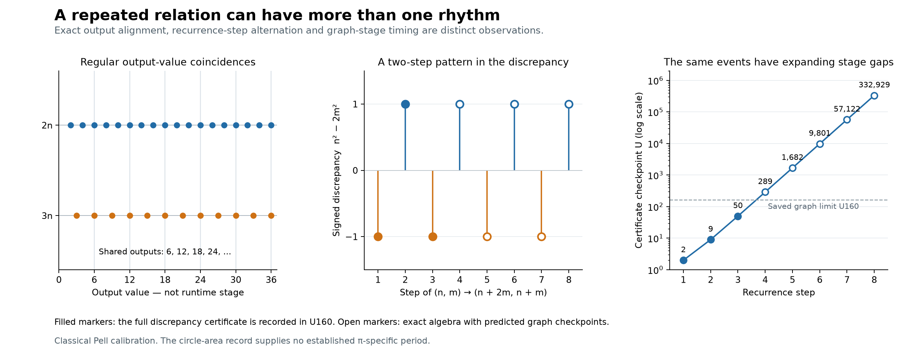

# Branch rhythm: what repeats, and on which clock?

Date: 2026-10-02

evidence_layer: external_probe
claim_status: observation

GNARGNARHEAD's polyrhythm analogy suggests inspecting how constructions agree, miss,
and meet again. A useful distinction survives the checks: a relation can repeat
at a fixed number of recurrence steps while its witnesses occur at increasingly
separated graph stages. This gives an inspection convention, not a new runtime
operation or a definition of all branches.

The strongest example here is the classical comparison of a square with two
equal squares. It is a deliberately simpler calibration for the analogy. It
does not establish a rhythm for pi or a native circle branch.

## Scope and evidence

The [frozen design](BRANCH_RHYTHM_20261002.pre.md) precedes this scan. The
[probe](branch_rhythm_probe.py) uses the existing positive-spine U160 graph
read-only. Only confirmed positive integers are operands. Fractions and
negative differences can be outputs; they are not promoted to runtime operands.

The complete [report](results/2026-10-02-branch-rhythm-v1/report.json) preserves
1,013 distinct requested arithmetic edges, including 648 actually recorded
edges with witness metadata and 365 requests outside the saved aperture whose
stages are predictions. The corpus hash was unchanged. A bundle checkpoint is
the earliest stage at which all its specified edges are available under the
current generator. It is neither a minimum over every possible certificate nor
a claim that those edges were executed in the order written in the probe.
Predictions beyond U160 assume the positive-spine and value apertures are
extended sufficiently under the same operand and stage rules; they are not
events already present in the saved finite graph.

The [independent verification](results/2026-10-02-branch-rhythm-v1/independent_validation.json)
reread all 648 recorded edges directly from SQLite, checked all 1,013 arithmetic
requests, searched 262,656 integer pairs, and checked the 30 rational windows.
All six focused tests passed. These finite checks accompany the proofs below;
they do not replace them.



## 1. Three meanings of alignment

For sources n=1,...,128, both n+n and n*n have a witness at stage U_n. Their
stage synchronization follows directly from the positive-spine generator's
stage=max(operands) rule. It supplies no additional timing law.

Other predicates give other answers:

| Inspection | Exact result | Clock or index |
| --- | --- | --- |
| Same source, n*n=n+n | n=2 only among positive sources | Source n |
| Shared outputs, 2n=3m | 6,12,18,... | Output value |
| Shared outputs, n*n=2m | 4,16,36,...,4k^2,... | Output value |
| Same-stage self-addition and self-multiplication witnesses | Every tested n | Graph stage U_n |

For the second row the source stages differ: the common value 6k comes from
2*(3k) and 3*(2k). In the third row the square source is 2k and the self-addition
source is 2k^2. The source-stage delay is 2k^2-2k, and successive shared output
values differ by 8k+4. Neither comparison is an equally spaced alignment in
every possible clock.

The bounded windows contained 42 common 2n/3m outputs and eight common
n^2/2m outputs. The formulas establish the unbounded arithmetic statements.
Witness identity and shared value remain separate questions.

## 2. Fractions give a precise value-level distinction

Let S={q^2 : q is a positive rational}. For a positive rational coefficient c,

    S intersects cS  <=>  c is a rational square.

Indeed, u^2=c*v^2 implies c=(u/v)^2. Conversely, if c=t^2 for rational t>0,
multiplying roots by t gives cS=S. The latter is equality of value sets; it
does not identify construction witnesses or declare two branches identical.

This includes fractional squares such as 9/4. The reduced numerator and
denominator of a rational square are both integer squares: coprimality prevents
cancellation between their prime factorizations. Thus 2, 3, and 1/2 fail this
criterion. Allowing rational roots does not create exact nonzero matches for
these coefficients.

The finite sets use reduced roots p/q with p,q<=H:

| H | Roots | Matches for c=1 | c=4 | c=9/4 | c=2,3,1/2, each |
| ---: | ---: | ---: | ---: | ---: | ---: |
| 4 | 11 | 11 | 8 | 6 | 0 |
| 8 | 43 | 43 | 30 | 18 | 0 |
| 16 | 159 | 159 | 110 | 82 | 0 |
| 32 | 647 | 647 | 434 | 312 | 0 |
| 64 | 2,519 | 2,519 | 1,694 | 1,266 | 0 |

For square coefficients, some matching roots fall outside a finite window;
this explains the partial counts. First, middle and last matches were selected
for witness inspection, with raw representations scaled by 1 and 2. Where
there was no match, (1,1) was the fixed comparison control. The complete count
is exact arithmetic; not every match has an individually audited graph bundle.

S is dense in the positive reals: between two positive bounds one can choose a
rational root between their square roots. There is therefore no next square
value in the full rational ordering. Any sequence of beats requires an explicit
enumeration or construction clock. This is one reason fractions matter to the
analogy rather than being an incidental extension of integer squares.

## 3. Recurring near-alignment without exact agreement

For c=2, choose the event n^2-2m^2=+/-1 with positive integer roots. A complete
search through m<=512 returns precisely:

| Step | n | m | n^2-2m^2 | Full integer certificate checkpoint |
| ---: | ---: | ---: | ---: | ---: |
| 1 | 1 | 1 | -1 | 2 |
| 2 | 3 | 2 | +1 | 9 |
| 3 | 7 | 5 | -1 | 50 |
| 4 | 17 | 12 | +1 | 289 |
| 5 | 41 | 29 | -1 | 1,682 |
| 6 | 99 | 70 | +1 | 9,801 |
| 7 | 239 | 169 | -1 | 57,122 |
| 8 | 577 | 408 | +1 | 332,929 |

Only the first three full integer discrepancy bundles lie within U160. Six
root transitions are recorded, including the transition (99,70)->(239,169).
Its outputs exist in U160 but cannot become operands there: their positive
spine confirmations occur later. A root transition does not wait for the much
later full discrepancy certificate.

The recurrence is

    T(n,m)=(n+2m,n+m).

Writing Q(n,m)=n^2-2m^2, direct expansion gives Q(T(n,m))=-Q(n,m).
Starting at (1,1), the signed discrepancy therefore has period two in the
recurrence index. This is a classical Pell-equation example; see
[Keith Conrad's notes](https://kconrad.math.uconn.edu/blurbs/ugradnumthy/pelleqn1.pdf).
The identity itself is elementary and independent of the finite scan.

Completeness also has a short proof. Any positive solution |Q|=1 with m>1
satisfies m<n<2m. The inverse transformation

    (n,m) -> (2m-n,n-m)

has positive entries, a smaller second entry, and negates Q. Repeated descent
ends at m=1, where the only positive solution is (1,1). Reversing the descent
recovers every positive solution from T. Each solution is primitive, since a
common divisor of n and m would have its square divide 1.

The root transitions have actual node continuity wherever the required edges
are recorded: m+m supplies the integer 2m used in n+2m, and earlier transition
outputs match later input node IDs. Confirmation and stage ordering were
checked separately. This supports a witnessed path selected by the external
recurrence; it does not activate a new native recurrence frame.

## 4. A fixed sign rhythm and expanding stage gaps

For the particular integer certificate used here, let

    B_k=max(n_k^2,2m_k^2)=(n_k^2+2m_k^2+1)/2.

The final directed subtraction and quotient witnesses need operands of this
size, so B_k is the joint bundle checkpoint under the positive-spine rule.
Let A=n^2+2m^2 and P=nm. The root recurrence gives

    A'=3A+8P,    P'=A+3P.

The transformation has trace 6 and determinant 1, so
A_(k+2)=6A_(k+1)-A_k. Substitution yields

    B_(k+2)=6B_(k+1)-B_k-2.

The observed checkpoint gaps are 7,41,239,1393,8119,47321,275807.
Their recurrence is G_(k+2)=6G_(k+1)-G_k. Starting from 7<41, this makes
them strictly increasing and unbounded. Thus these certificate events cannot
be eventually periodic on the integer stage axis: a nonempty infinite periodic
event set would have bounded gaps.

This proves a distinction for this chosen certificate and clock. It says
nothing about the optimal cost of all equivalent proofs, or about every other
possible branch event.

## 5. What survives rescaling

Use rational roots x=lambda*n/q and y=lambda*m/q, with positive integer
lambda and q. Their directed area discrepancy is

    x^2-2y^2=(lambda/q)^2 * Q(n,m).

The raw gap therefore changes with the unit. The relative signed discrepancy

    (x^2-2y^2)/y^2 = Q(n,m)/m^2

does not. The tested lambda=1,2 and q=1,3 preserve this value exactly while
retaining distinct raw witnesses and certificate costs. Arithmetic involving
fractions was encoded through positive integer numerators and denominators.

For these primitive solutions the relative discrepancy is +/-1/m^2. The
ratios n/m therefore alternate about sqrt(2) with decreasing relative square
error. This relates the repeating sign to improving approximation; no decimal
value of sqrt(2) was used to select the pairs.

Neighbor controls expose a useful caution. (18,12) fails the raw unit-gap test
but reduces to (3,2), and (578,408) reduces to (17,12). Their primitive relations
return to the same family. Calling all neighboring pairs failures would silently
mix a raw representation test with a test of normalized structure.

## 6. Return to the square/circle inspection

The earlier [area inspection](../geometry/AREA_INSPECTION_BRANCH_20261001.analysis.md)
has three methods and seven imposed dyadic refinement levels. Counting square
probes that become definitely below, above, or equal to the area for the first
time gives:

| N | Exact polygon | Rounded polygon | Grid |
| ---: | ---: | ---: | ---: |
| 1 | 458 | 458 | 0 |
| 2 | 139 | 120 | 323 |
| 4 | 39 | 55 | 153 |
| 8 | 8 | 9 | 84 |
| 16 | 3 | 5 | 42 |
| 32 | 1 | 0 | 25 |
| 64 | 0 | 1 | 9 |

These are retrospective counts over the same 648 probes, not new independent
evidence. The polygon methods eventually settle all of them; the grid leaves
12 unresolved. Their differing arrival patterns depend on the inspection
method, even while their valid area bounds address the same comparison cut.
Nothing in these seven scheduled samples establishes a pi-specific period.
This does not rule out a useful recurrence under another justified inspection.

The Pell comparison is consequently a calibration of the proposed language,
not an explanation of circle area. The previous obligation remains: specify
what makes the construction a circle independently of the scalar area result.

## Provisional definition point and decision

A **branch-comparison inspection** specifies:

1. The field and repeated witnessed relations being compared.
2. The event predicate: shared value, same-stage witness, or a named discrepancy.
3. The clock: source, output order within a finite aperture, recurrence step,
   or graph stage.
4. The normalization and the raw witnesses retained alongside it.

A **rhythm** is a demonstrated regularity of that inspection. It must name
which of those choices the regularity survives. Periodicity is one possible
regularity, not an automatic consequence of calling the observation rhythmic.

This convention preserves the project's distinction between a branch and its
recurrence frame. It also preserves GNARGNARHEAD's distinction between a value and the
method by which it is inspected. Adopt it provisionally in research discussion;
do not promote it to a new core axiom or a circle characterization.

The next substantive circle question is which comparison events follow from
the construction itself, before selecting a convenient clock or recurrence.
The current evidence does not answer that question.

## Reproduction and retained artifacts

From the project root, use a fresh output directory:

```sh
python3 -B research/dynamics/branch_rhythm_probe.py --output-dir /tmp/moo-branch-rhythm-reproduction
python3 -B -m unittest research.dynamics.test_branch_rhythm_probe
python3 -B research/dynamics/verify_branch_rhythm.py /tmp/moo-branch-rhythm-reproduction/report.json
python3 -B research/dynamics/plot_branch_rhythm.py /tmp/moo-branch-rhythm-reproduction/report.json
```

The probe and verifier use the Python standard library; plotting requires
Matplotlib. The probe refuses an existing output directory. The verifier
refuses to overwrite its validation record.

- [Summary](results/2026-10-02-branch-rhythm-v1/summary.json)
- [Independent verifier](verify_branch_rhythm.py) and [tests](test_branch_rhythm_probe.py)
- [Plot source](plot_branch_rhythm.py), [PDF](results/2026-10-02-branch-rhythm-v1/branch_rhythm_clocks.pdf), [SVG](results/2026-10-02-branch-rhythm-v1/branch_rhythm_clocks.svg)
- Corpus SHA-256: `8c31e7da4dc5d359df31b7fa18b195c14e6b190426c704a5c6d4f4bff7e11fb7`
- Report SHA-256: `b844283b70fbedfa1c98e387c18ffbb4d1547e86c1dc32fd3c0ffa7c32452563`
- Earlier area report SHA-256: `512126ea7e4db9671710af7a2df4a51368d8e388a3c45366bd89f98b1023ab9d`
