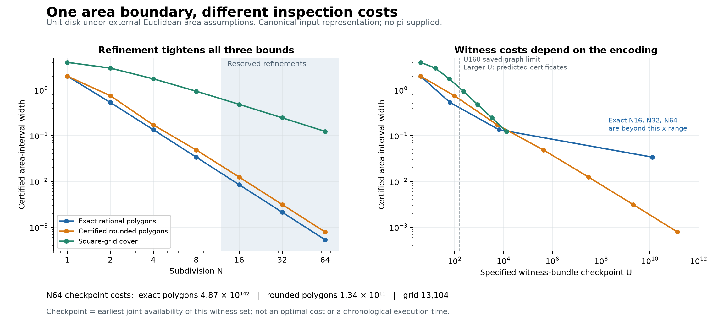

# A witnessed area-comparison boundary on the square branch

Date: 2026-10-01

evidence_layer: external_probe
claim_status: candidate (definition); observation (finite comparison)

The useful definition point is an **area-comparison boundary**: a persistent
separation of rational-square constructions certified below an area from
those certified above it. Different valid inspections approach the same
boundary while retaining different witnesses and readiness costs.

This gives a precise object to investigate. It does not single out a native
circle branch: the region, Euclidean metric, containment, and area measure
are explicit external assumptions. The boundary construction works for other
areas, and even different shapes can have exactly the same boundary.

## What was fixed and tested

The [frozen design](AREA_INSPECTION_BRANCH_20261001.pre.md) specified:

- exact rational inscribed/tangent polygons;
- the same polygon contributions rounded outward to denominator N^3, with
  integer certificates for each rounding decision;
- square-grid lower and upper covers;
- disk, diamond and square comparisons;
- N=1,2,4,8 calibration and N=16,32,64 reserved continuation;
- the equivalent raw parameter representations k/N and 2k/(2N);
- all reduced positive roots p/q<=2 with q<=32: 160 roots at q<=16 and
  488 additional roots at q=17..32.

These are 648 distinct rational-square values. Integers and fractions are
both included. No pi, sqrt(pi), trigonometric values, or approximation-table
coefficients were inputs.

The 98 interval records contain every candidate classification and selected
comparison certificates. The continuation is a deterministic out-of-range
check; it is not an independent random sample or a discovery of a new law.

## The candidate definition

Let W be a square-construction certificate with positive rational value v(W).
For example, with x=p/q, retain the witnesses for p*p=P, q*q=Q, p/q=x and
P/Q=v. The equality v=x*x is the external algebraic meaning of this certificate.
It does not claim a literal fractional-input self-product edge in the current
positive-spine field. Integer squares are the q=1 cases.

Fix a region K, its area rule, and a family of certified rational intervals

    L_n <= Area(K) <= U_n,       U_n-L_n -> 0.

Define two witness-indexed families:

    Below(K) = {W : v(W) < L_n for some finite n}
    Above(K) = {W : v(W) > U_n for some finite n}.

Each comparison is certified by integer cross-products and a positive
difference. The arithmetic witnesses remain attached; equal value does not
identify construction histories. An unclassified finite case is unresolved,
not an equal-area hit. Exact equality is admitted only with its own certificate,
as in the square control with area 4 and root 2.

The boundary is a cut in the **ordered values of the branch**, lifted back to
their witnesses. It is not an additional rational node. For the external unit
disk the boundary in area values is classically pi; on the root coordinates
it is sqrt(pi). This statement identifies the geometric interpretation after
constructing bounds; neither constant was used to select candidates.

### Why independent valid methods define the same boundary

Write A=Area(K). If v<A, choose n so U_n-L_n<A-v. Because U_n>=A,

    L_n >= A-(U_n-L_n) > v.

Thus some finite lower certificate places v below. Conversely, v<L_n<=A
implies v<A. The same argument above A proves

    Below(K) has exactly the square values v<A;
    Above(K) has exactly the square values v>A.

Consequently any two valid shrinking-bound methods classify the same values
eventually. Positive rational squares are dense in the positive reals, so
this comparison determines a unique real boundary under the external real
completion. The proof is classical and conditional on the stated area and
convergence assumptions. The finite data check implementations; they do not
prove method independence merely by agreement.

One may take the running maximum of lower bounds and running minimum of upper
bounds to preserve all earlier certificates even when an individual refinement
scheme is not nested. The particular dyadic levels here were independently
verified to be nested without that repair.

## Results of the comparison

There were no opposite definite classifications, no loss of a previously
certified classification, and no representation-dependent interval or
classification. The diamond and square controls bounded 2 and 4 correctly.
Both square-control methods recognized the exact rational-square value 4.

At N64, the intervals (decimals here are display approximations) are:

| Method | Lower | Upper | Width | Unresolved square values, of 648 |
| --- | ---: | ---: | ---: | ---: |
| Exact polygons | 3.1412381672 | 3.1417699170 | 0.0005317497 | 0 |
| Rounded polygons | 3.1411056519 | 3.1418914795 | 0.0007858276 | 0 |
| Grid | 3.0751953125 | 3.1992187500 | 0.1240234375 | 12 |

Both polygon methods certify 574 of the inspected square values below and 74
above. The grid certifies 568 below and 68 above, with 12 still unresolved.
This is finite-envelope resolution, not resolution of every rational square.

Some comparisons illustrate different arrival times:

| Root whose square is compared | Eventual status | Exact polygon first certified N | Rounded polygon first certified N | Grid through N64 |
| --- | --- | ---: | ---: | --- |
| 7/4 | below | 8 | 8 | below at 64 |
| 16/9 | above | 8 | 16 | unresolved |
| 23/13 | below | 16 | 16 | unresolved |
| 39/22 | above | 32 | 64 | unresolved |

For example, the inspections independently certify

    (23/13)^2 < Area(unit disk) < (39/22)^2.

The tighter numerical intervals arise from area witnesses. The two displayed
square values are illustrative members of the branch that those witnesses
classify; they were not fitted against a supplied pi.

## The refinement proofs

For adjacent rational parameters a=k/N and b=(k+1)/N, put

    w=(b-a)/(1+a*b)=N/(N*N+k*(k+1)).

The four-quadrant lower and upper contributions are 4w/(1+w*w) and 4w.
Their gap is 4w^3/(1+w*w). Since 0<w<=1/N, summing N pieces gives

    exact polygon width <= 4/N^2.

Rounding each lower contribution down and each upper contribution up to
denominator N^3 adds at most 2N/N^3, hence

    rounded polygon width <= 6/N^2.

For the inclusive grid cover, let f(i)=floor(sqrt(N^2-i^2)). The lower
quarter count is sum_{i=1}^N f(i); the upper is
sum_{i=0}^{N-1} min(N,f(i)+1). Their difference telescopes to 2N-1, so

    grid width = 4(2N-1)/N^2 -> 0.

The square root here selects an integer. Its inequalities are checked through
self-products and positive differences; it is not a new runtime primitive.
The diamond grid has the same width formula. This rate alone is therefore
not a circle-specific signature.

## What construction cost revealed

The chosen compiler clears rational operations into positive-integer witness
bundles and certifies denominator reductions and rounding decisions. The
reported stage is the largest operand among the requested edges: the earliest
joint checkpoint for that specified bundle under adequate retention.

**This is not a chronological execution trace or a minimum-cost theorem.**
Some checking and normalization edges can appear after other edges using the
same integer node. The bundle records agreeing constructions by a checkpoint;
it does not prove that every downstream occurrence causally used the chosen
upstream occurrence. External selection/search, geometry proofs and counting
are also outside this metric. These distinctions matter when saying "how we
get there."

| Method | N8 width | N8 checkpoint | N64 width | N64 checkpoint |
| --- | ---: | ---: | ---: | ---: |
| Exact polygons | 0.0339829 | 12,651,380,374 | 0.00053175 | about 4.87e142 |
| Rounded polygons | 0.0488281 | 434,176 | 0.00078583 | 134,251,282,432 |
| Grid | 0.9375 | 224 | 0.12402344 | 13,104 |

The enormous exact-polygon costs are not solely a bad summation order. For a
noninteger reduced output p/q, only integer division can create it in the
positive-spine arithmetic. Any integer pair producing it is (kp,kq), k>=1.
Thus its earliest possible value landing is at least U_max(p,q). For the N8
and N64 exact-polygon bounds this lower bound equals the measured certificate
checkpoint. Large exact denominators alone force these large stages in the
abstract positive-spine rule.

Rounding changes the required rational outputs. It sacrifices a little
precision while avoiding those enormous final denominators. Its own gap
between final-value landing cost and full-certificate cost is substantial,
so further arithmetic-route improvements are conceivable. The observed
comparison does not establish universal optimality of any method.

Raw parameter rescaling preserves intervals but can increase checkpoints.
For example N4 exact polygons move from U6486 to U16384; N4 grid from U60 to
U240. The N2 exact-polygon checkpoint U64 differs from the earlier hand-built
calibration's U40 because this general schema also retains the raw parameter
endpoint shell and its square witnesses. These are different witness sets.

Only U160 is saved and audited. Of 10,468 distinct requested arithmetic edges,
1,790 are actually present and independently reread there. The other 8,678
are exact integer admissibility certificates with predicted stages. They are
not recorded events in a larger saved universe. Huge stage predictions refer
to the mathematical rule with unbounded integers, not to an existing SQLite
corpus or a promise that the current storage implementation can realize them.



## Why this cannot define the circle by area alone

The controls show that the construction also defines boundaries for areas 2
and 4. A stronger counterexample follows exactly from an area-preserving
rational change of coordinates:

    (X,Y)=(2x,y/2).

It sends the unit disk to the ellipse

    X^2/4 + 4Y^2 <= 1.

Its determinant is 1. Therefore every rational polygon and its transformed
polygon have exactly the same area; inner and outer containment are preserved.
The entire polygon-bound sequence and square-branch classification can be
identical for these different Euclidean shapes. This counterexample is an
algebraic consequence identified during interpretation, not a preregistered
statistical test.

The area-comparison boundary specifies an area class. A circle-specific
definition needs additional information about metric, equal directions,
incidence or the witnessed transformations. No circle-specific native
selection principle was found in this comparison.

## What is established and what remains open

Established conditionally in external mathematics: valid shrinking area
bounds define the same comparison cut on positive rational squares. The three
disk schemes have explicit convergence certificates.

Observed: all 98 finite interval cases and 63,504 candidate comparisons passed
the checks; their admissible integer encodings preserve rational-square scope;
the retained U160 evidence agrees with the arithmetic and stage predictions.

Candidate definition: a witness-indexed area-comparison boundary, retaining
inspection method, exact certificate, field and checkpoint with each decision.
This is a defensible interpretation object on branches, not a new runtime
object or a replacement foundation.

Open: whether a relation selected from MoO's witnesses can privilege the
circle interpretation without supplying its geometric selector. A useful
next inquiry would compare the witnessed transformation/metric information
of the circle and determinant-one ellipse example while their area boundary
is held fixed. Another separate question is genuinely chronological lineage;
joint availability alone should not be promoted into that claim.

## Evidence and reproduction

- [Frozen design](AREA_INSPECTION_BRANCH_20261001.pre.md).
- [Certificate implementation](area_branch_comparison.py).
- [Focused tests](test_area_branch_comparison.py).
- [Full report](results/2026-10-01-area-branch-comparison-v1/report.json).
- [Compact comparison](results/2026-10-01-area-branch-comparison-v1/summary.json).
- [Independent verifier](verify_area_branch_report.py) and
  [saved validation](results/2026-10-01-area-branch-comparison-v1/independent_validation.json).
- [Plot source](plot_area_branch_comparison.py),
  [PDF figure](results/2026-10-01-area-branch-comparison-v1/area_inspection_comparison.pdf),
  [SVG figure](results/2026-10-01-area-branch-comparison-v1/area_inspection_comparison.svg).

Run from the repository root, choosing a fresh output directory:

```bash
python3 -B -m unittest research.geometry.test_area_branch_comparison -v
python3 -B research/geometry/area_branch_comparison.py --output-dir research/geometry/results/area-branch-new-run
python3 -B research/geometry/verify_area_branch_report.py research/geometry/results/area-branch-new-run/report.json
python3 -B research/geometry/plot_area_branch_comparison.py research/geometry/results/area-branch-new-run/report.json
```

The plot alone needs matplotlib. All mathematical computation and verification
use the standard library. The original U160 corpus was opened read-only and
its SHA-256 remained unchanged. Six focused tests passed. The independent
readback recomputed all 10,468 edge arithmetic results, reread the 1,790 actual
SQLite edges, checked all interval and candidate records, enumerated grid
cells independently through N64, and checked nesting, persistent decisions,
and source hashes. Other research records and core rules were not changed.
